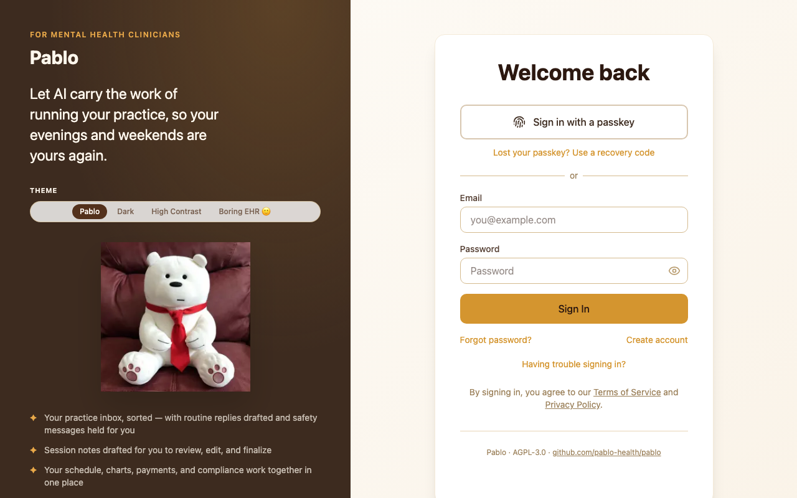
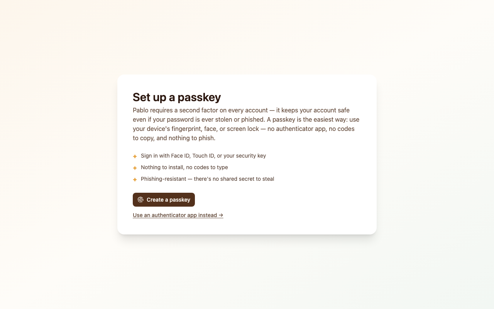
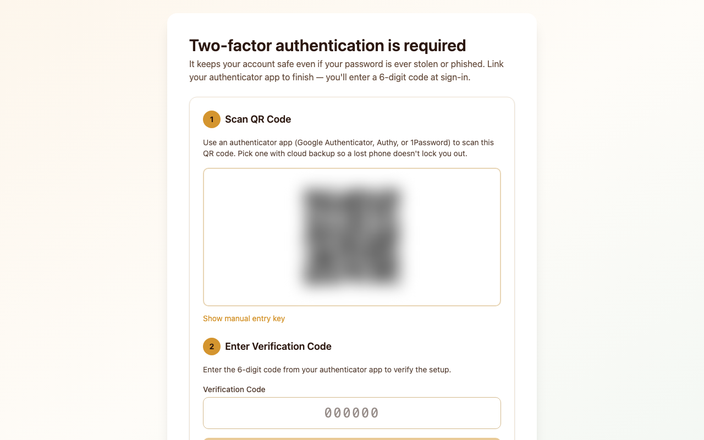
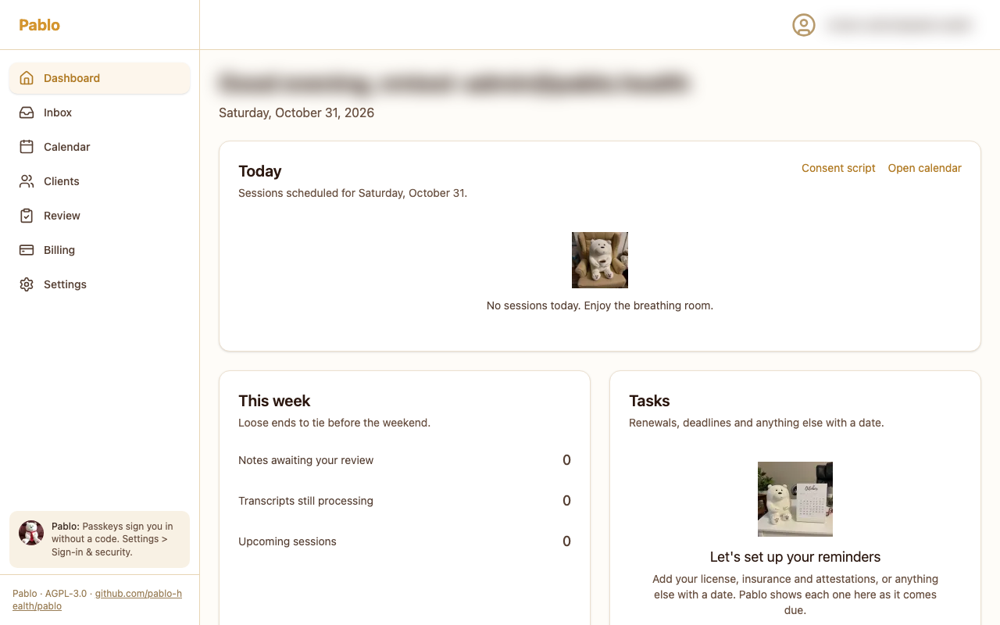
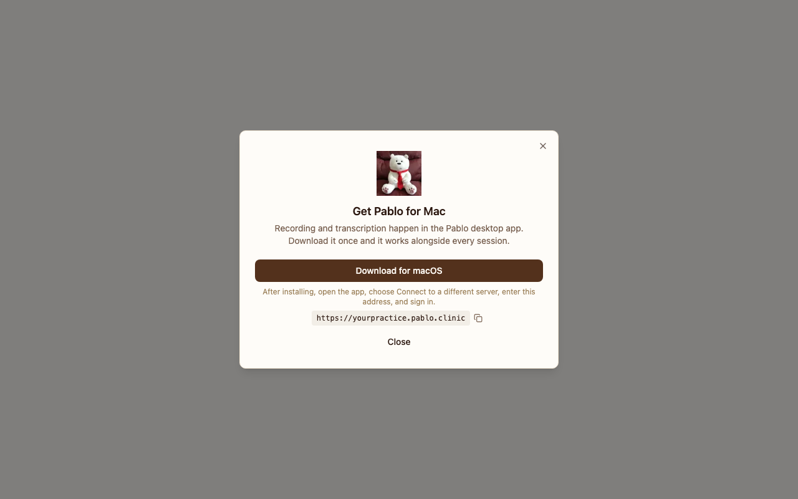
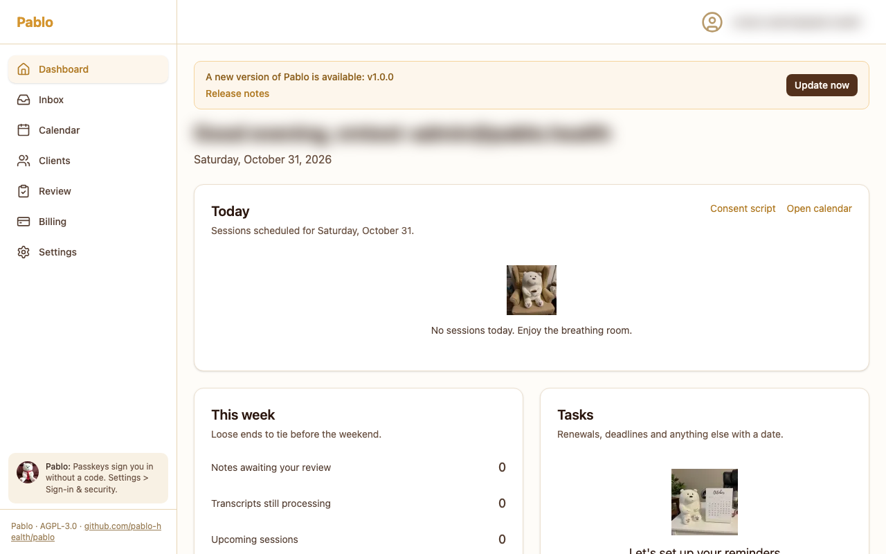

# Start here: Pablo on your own Google Cloud

This guide takes you from a Google account to recording your first session.
Pablo runs on one small server in your own Google Cloud account, and your
records stay there.

The install takes about 15 minutes, plus a few minutes for each optional
step.

## 1. What you need before you start

- **A Google account.** Any account works. If you use Google Workspace for
  your practice, use that one.
- **A billing account with a card on it.** If you have never used Google
  Cloud, [add one here](https://console.cloud.google.com/billing/create).
- **Google's Business Associate Agreement (BAA), accepted by an administrator
  of your account.** It is free and takes a few minutes:
  [how to accept it](https://cloud.google.com/security/compliance/hipaa).
  Keep client records out of Pablo until it is accepted.
- **About $20 a month,** billed by Google: the server, its disks, its
  address and storage. AI notes and transcription are billed by use on top.

## 2. Open Cloud Shell

Cloud Shell is a terminal in your browser, run by Google. Nothing is
installed on your computer.

Click **Open in Cloud Shell** in the [README](../../README.md#install). Sign
in with the Google account from step 1. If Google asks whether to trust the
repository or to authorize Cloud Shell, confirm. A terminal opens with a
short guide beside it.

## 3. Run the installer

In the terminal, run:

```bash
./install.sh
```

It asks its questions first and creates nothing until you confirm.

```text
Your email (you sign in with it):
```

The email you will sign in with. At first, it is the only one that can sign
in.

```text
Google Cloud project [new: pablo-1a2b3c]:
```

Press Enter for a new project.

```text
Pablo's address, for you and your clients:
  1  your own domain; you add one DNS record for it
  2  a name you choose at pablo.clinic, such as yourpractice.pablo.clinic
  3  an automatic address made from the server's IP; it works, but looks odd
Choose 1, 2 or 3 [3]:
```

We recommend **2**. You choose a name, the installer checks it is free, and
there is nothing else to set up. Names use 3 to 40 lowercase letters,
numbers and hyphens. The names come from an optional hosted-subdomain service
that only keeps the DNS record: your traffic goes straight to your server.

Choose **1** if you already have a domain and can add an A record to it; the
installer tells you the address to point it at. Choose **3** to skip the
question for now. You can [move to your own domain later](#10-move-to-your-own-domain-later).

```text
Also sign in with Google and sync Google Calendar? Needs one step in the console. [y/N]
```

Press Enter for now. [Section 6](#6-google-sign-in-and-google-calendar) adds
it later.

```text
Pablo can transcribe sessions with AssemblyAI, under your own signed BAA
with AssemblyAI: https://www.assemblyai.com/legal/business-associate-agreement
Turn on transcription? You can add it later. [y/N]
```

Answer **y** if you have an AssemblyAI API key and a signed BAA with
AssemblyAI. Otherwise press Enter; [section 5](#5-transcription) adds it
later.

```text
Your records are covered by Google's Business Associate Agreement once an
administrator of your Google Cloud account accepts it, one time:
  https://cloud.google.com/security/compliance/hipaa
Is it accepted? [y/N]
```

Then it shows what it will set up and what it costs, and asks you to
continue. When it finishes, it prints your address:

```text
Pablo is running: https://yourpractice.pablo.clinic
```

### Save your backup passphrase

At the very end, the installer shows your backup passphrase once:

```text
Your backup passphrase
  <64 characters>
Your backups are encrypted with it, and restoring them needs it. Keep it
outside this Google account: in a password manager, or printed.
```

Copy it into a password manager now, or print it and keep it somewhere safe.

Google keeps the only other copy, in the same account as the backups. If you
ever lose access to that account, your copy is the one that lets you restore.

## 4. Sign in for the first time

1. Open your Pablo address and choose **Create account**.
2. Use the email you gave the installer, and a password of at least 15
   characters.
3. Open the verification email and follow its link. If it has not arrived,
   check your spam folder.
4. Sign in.
5. Add a second factor. Pablo asks for one on every account.



**A passkey** is the easiest: your device's fingerprint, face or screen lock.
Choose **Create a passkey**. Pablo then shows recovery codes; save them with
your backup passphrase.



**An authenticator app** on your phone works too, including when the device
you sign in on cannot make a passkey. Choose **Use an authenticator app instead**, scan the code with an
app such as Google Authenticator, Authy or 1Password, and enter the 6-digit
code it shows.



Then you are in.



## 5. Transcription

Pablo drafts your session notes from a transcript of the session.
Transcription turns the desktop app's recording into that transcript. It uses
AssemblyAI, which needs your own AssemblyAI account and a signed BAA with
AssemblyAI before any session audio is sent:
[AssemblyAI's BAA](https://www.assemblyai.com/legal/business-associate-agreement).

To turn it on later, open Cloud Shell again with the README's button and run
the installer with your project:

```bash
./install.sh --project <your-project-id>
```

It asks the same question:

```text
Turn on transcription? You can add it later. [y/N]
```

Answer **y** and paste your AssemblyAI API key when it asks
(`AssemblyAI API key (hidden):`). The rest of the run keeps what you set up
before, and restarts Pablo with transcription on.

## 6. Google sign-in and Google Calendar

One step in the Google Cloud console turns on both: sign-in with your Google
account, and syncing your Google Calendar. Your calendar data goes from Google
to your server and nowhere else.

Run the installer again with your project and answer **y**:

```bash
./install.sh --project <your-project-id>
```

```text
Also sign in with Google and sync Google Calendar? Needs one step in the console. [y/N]
```

It then prints the console steps with your project's links and addresses
filled in. In short:

1. Set up the consent screen: app name "Pablo", your email. Choose
   **Internal** if you use Google Workspace, otherwise **External**.
2. Under **Data access**, add the four calendar scopes it lists.
3. If you chose External, publish the app so it is "In production". Google
   shows a one-time "unverified app" screen when you connect your calendar;
   that is expected for your own app.
4. Create an OAuth client ID of type **Web application**, named "Pablo", with
   the origins and redirect URIs it prints.
5. Paste the client ID and secret into the installer.

Then connect your calendar in Pablo's settings.

## 7. The desktop app

Recording happens in the Pablo desktop app.

- **Windows:** [Pablo in the Microsoft Store](https://apps.microsoft.com/detail/9N0260HFX1JC)
- **Mac:** [download Pablo.dmg](https://github.com/pablo-health/pablo-companion/releases/latest/download/Pablo.dmg)

Once you have sessions on today's schedule, the dashboard offers the right
one for your computer too (**Don't have it yet?**), with your address and a
copy button.



The desktop app needs your Pablo's address once:

1. Open the app. On its sign-in screen, choose **Connect to a different
   server**.
2. Enter your Pablo address in **Server URL**, for example
   `https://yourpractice.pablo.clinic`.
3. Sign in.

From then on, **Start session** on the dashboard opens the desktop app. The
first time, your browser may ask whether to open Pablo; allow it.

## 8. Updates

When a new release is published, the owner and admins of your practice see a
notice in Pablo with a link to the release notes. Choose **Update now**.
Pablo takes a backup, updates, and checks the new version is working. If it
is not, it goes back to the version you had. Pablo is unavailable for about
a minute while it updates.



You can also update from Cloud Shell, naming the release:

```bash
gcloud compute ssh pablo --project=<your-project-id> --zone=us-central1-a --tunnel-through-iap -- sudo pablo-update vX.Y.Z
```

The commands in this guide use the installer's default zone, `us-central1-a`.
If you chose another, use yours.

## 9. Backups and the monthly restore check

Your server backs up its database every night to Cloud Storage in your
project, encrypted with your backup passphrase. It also keeps 14 days of disk
snapshots.

On the 2nd of each month it restores the latest backup into a scratch copy
and checks it answers. That check is your evidence that backups restore, so
look at it once a month and keep a note of the result:

```bash
gcloud compute ssh pablo --project=<your-project-id> --zone=us-central1-a --tunnel-through-iap
sudo journalctl -t pablo-backup     # look for "restore_drill" with "status":"ok"
sudo pablo-backup info              # every backup the bucket holds
sudo pablo-backup restore-drill     # run the check now
```

More on backups and restoring: [Operating the VM install](operations.md).

## 10. Move to your own domain later

1. Add an A record for your domain, pointing at your server's address. The
   installer printed it as `https://yourpractice.pablo.clinic → <address>`,
   and this shows it again:

   ```bash
   gcloud compute addresses describe pablo --region=us-central1 --project=<your-project-id> --format='value(address)'
   ```

2. Run the installer again with your domain:

   ```bash
   ./install.sh --project <your-project-id> --hostname clinic.example.com
   ```

3. Release the old name. The installer prints the command at the end:

   ```bash
   gcloud compute ssh pablo --project=<your-project-id> --zone=us-central1-a --tunnel-through-iap -- sudo pablo-name release yourpractice
   ```

**Passkeys belong to an address.** After a move, your passkey does not work at
the new address. Sign in with your authenticator app, or with a recovery code
(**Lost your passkey? Use a recovery code** on the sign-in page), then add a
new passkey under **Settings > Sign-in & security**.

**The desktop app** needs the new address too: sign out, choose **Connect to
a different server**, and enter it.

**If you set up Google sign-in,** add the new address to your OAuth client in
the console: under **Authorized JavaScript origins**, and as the first and
last of the redirect URIs the installer listed, with the new address in place
of the old.

## 11. If something goes wrong

**The installer stopped.** It prints the command that picks up where it left
off, for example:

```text
Stopped. To pick up where this left off:  ./install.sh --project pablo-1a2b3c --hosted-name yourpractice
```

Run that command. Running the installer again is safe: it never touches your
records.

**The server stopped while installing.** The installer says which step and
how to read the server's log:

```bash
gcloud compute instances get-serial-port-output pablo --project=<your-project-id> --zone=us-central1-a | grep pablo-
```

**Something is wrong after the install.** Pablo's logs, and those of its
scheduled jobs, are in **Logging** in the Google Cloud console for your
project. On the server, `journalctl -t pablo-job` and
`journalctl -t pablo-backup` show the jobs and backups.

More detail: [deploy/vm/README.md](../../deploy/vm/README.md) for the server,
[Operating the VM install](operations.md) for day-to-day care, and the
[Self-Hosting HIPAA Guide](../SELF_HOSTING_HIPAA_GUIDE.md) for what is yours
to look after.
